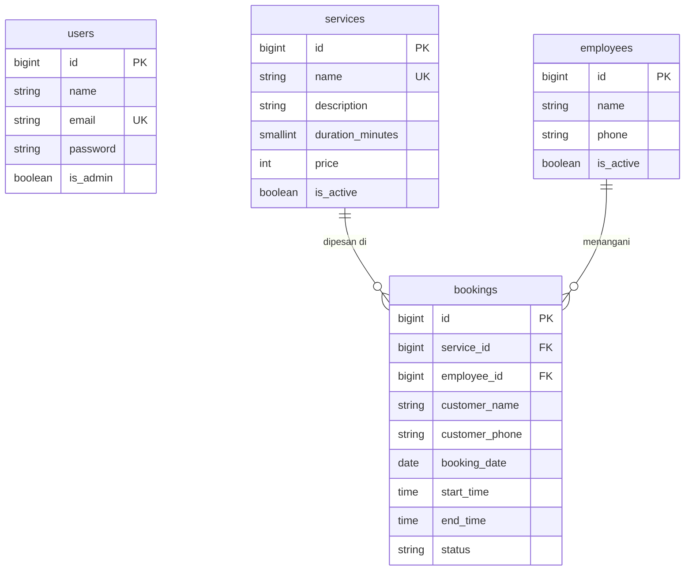

# Desain Database (MySQL)

## Tabel dan relasi



`users` adalah tabel bawaan Laravel ditambah kolom `is_admin`. Migration ada di `database/migrations`
(satu perubahan per file, semua punya `down()`).

## Alasan desain

| Keputusan | Alasan |
|---|---|
| `price` bertipe integer | Rupiah tidak punya sen. Integer menghindari masalah pembulatan float. |
| `duration_minutes` di `services` | Durasi menentukan jam selesai booking, dan dipakai untuk cek bentrok. |
| `end_time` disimpan di `bookings` | Query bentrok jadi perbandingan kolom biasa, dan riwayat tidak berubah kalau durasi layanan diedit. |
| `employee_id` diisi otomatis, nullable | Pelanggan tidak memilih pegawai. Sistem memilih pegawai yang kosong, sehingga kapasitas salon = jumlah pegawai aktif. `nullOnDelete` menjaga riwayat jika pegawai dihapus. |
| `service_id` memakai `restrictOnDelete` | Layanan yang sudah punya booking tidak boleh terhapus. Admin diminta menonaktifkan (`is_active`). |
| `status` string + PHP Enum | Mudah dibaca di database, dan nilainya dijaga lewat `BookingStatus` di kode. |
| `customer_phone` disimpan `62...` | Satu format memudahkan link `wa.me` dan pencarian. |
| Tidak ada tabel `customers` | MVP tanpa akun pelanggan. Bisa ditambah nanti kalau perlu riwayat per pelanggan. |
| `services.name` unique | Mencegah layanan ganda, dijaga di database dan di validasi. |

## Index

- `bookings (booking_date, start_time)`: dipakai cek bentrok (tanggal sama, rentang jam) dan
  pengurutan daftar booking di admin.
- `bookings.service_id` dan `bookings.employee_id`: index otomatis dari foreign key.
- `services.is_active` dan `employees.is_active`: dipakai filter `active()`.
- Kolom `status` sengaja tidak di-index: hanya 3 nilai, dan data salon kecil.

## Cek bentrok

Dua rentang waktu bentrok jika `start_lama < end_baru AND end_lama > start_baru`, pada tanggal
dan pegawai yang sama. Booking `dibatalkan` tidak dihitung. Jam selesai tepat saat jam mulai
berikutnya (11:00) tidak dianggap bentrok.

Untuk dua booking yang masuk bersamaan, `BookingService` memakai transaksi dan
`lockForUpdate()` pada baris pegawai, sehingga pemeriksaan dan penyimpanan berjalan berurutan.

## Memverifikasi query

```sql
EXPLAIN SELECT employee_id FROM bookings
WHERE booking_date = '2026-11-19'
  AND start_time < '11:00:00' AND end_time > '10:00:00'
  AND status != 'dibatalkan';
```

Kolom `key` seharusnya menunjukkan `bookings_booking_date_start_time_index`.

## Catatan MySQL vs SQLite

Aplikasi dijalankan di MySQL, sedangkan tes otomatis memakai SQLite in-memory. Kolom `booking_date`
di-cast `date:Y-m-d` supaya tersimpan sebagai `2026-11-19` di keduanya. Tanpa format eksplisit,
Eloquent menyimpan `2026-11-19 00:00:00` yang membuat perbandingan tanggal gagal di SQLite.

## Perbaikan yang mungkin nanti

- Tabel pivot `employee_service` kalau tiap pegawai punya keahlian berbeda.
- Kolom `price` di `bookings` (snapshot harga saat booking) kalau harga sering berubah.
- Tabel `closed_dates` untuk libur.
