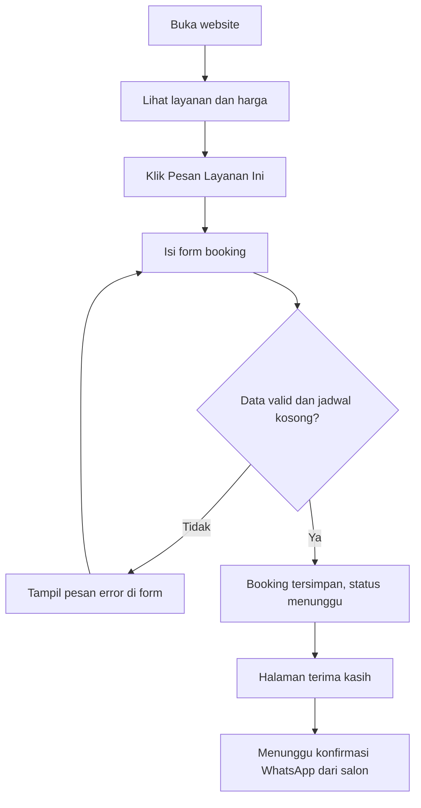
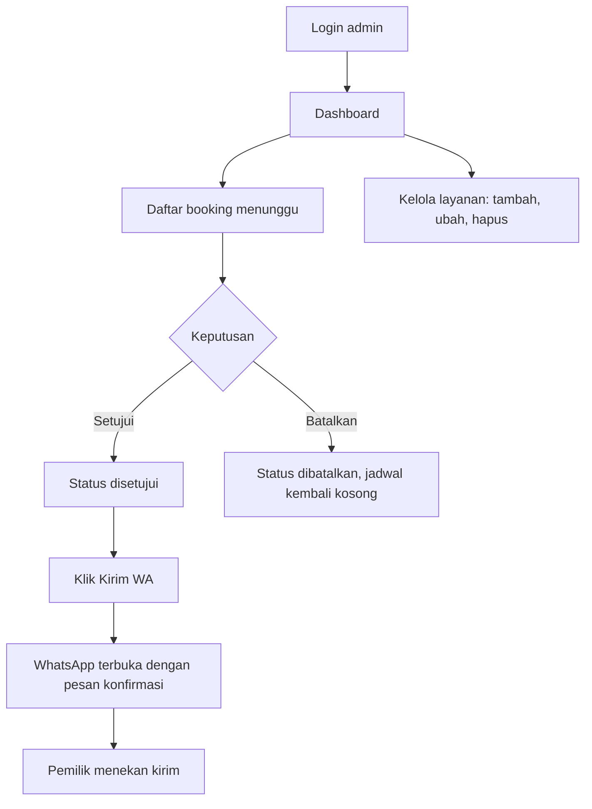

# Perencanaan

Website salon di Surabaya, dibuat dengan Laravel dan Bootstrap 5. Ada dua jenis pengguna:
**pelanggan** (tanpa akun) dan **pemilik/admin** (login).

## Fitur MVP

### Halaman publik
- Beranda: hero, keunggulan, layanan pilihan, ajakan booking
- Daftar layanan beserta durasi dan harga
- Galeri foto (dibaca dari folder, tinggal tambah file)
- Kontak: alamat, jam buka, tombol WhatsApp, peta Google Maps
- Tampilan nyaman di HP

### Booking
- Form: nama, nomor WhatsApp, layanan, tanggal, jam
- Validasi lewat Form Request, nomor WhatsApp dinormalisasi ke format `62...`
- Cegah jadwal bentrok (per pegawai, booking dibatalkan tidak dihitung)
- Tersimpan dengan status `menunggu`
- Halaman konfirmasi setelah kirim

### Panel admin
- Login (Laravel Breeze) dan logout, akses hanya untuk admin
- Dashboard ringkas: jumlah menunggu, booking hari ini, layanan aktif
- Daftar booking dengan filter status dan tanggal
- Setujui atau batalkan booking
- Tombol "Kirim WA" untuk booking yang sudah disetujui (link `wa.me`)
- CRUD layanan (nama, deskripsi, durasi, harga, aktif/nonaktif)

### Sengaja belum masuk MVP
Pilih pegawai oleh pelanggan, CRUD pegawai dan galeri lewat admin, lupa password lewat email,
pengingat otomatis, laporan pendapatan, DP/pembayaran online, tampilan slot kosong real-time.

## Urutan pengerjaan per minggu

| Minggu | Fokus | Hasil |
|---|---|---|
| 1 | Setup proyek, database | Laravel jalan, migration, model, seeder, repo Git |
| 2 | Halaman publik | Layout, beranda, layanan, galeri, kontak responsif |
| 3 | Booking | Form, Form Request, cek bentrok, tes otomatis |
| 4 | Panel admin | Login, middleware/policy, kelola booking, CRUD layanan |
| 5 | WhatsApp, rapikan, rilis | Tombol wa.me, isi konten asli dari ibu, review kode, README, deploy |

Kalau waktu longgar, minggu 6 dipakai untuk masukan dari ibu dan perbaikan kecil.

## Alur pengguna

### Pelanggan

### Pemilik salon

## Keputusan teknis singkat
- **Bootstrap lewat CDN**: tidak perlu Node/Vite, cukup `composer` dan `php artisan`.
- **Tanpa akun pelanggan**: pelanggan salon jarang mau daftar; cukup nama dan nomor WhatsApp.
- **Konfirmasi lewat WhatsApp manual**: gratis, tanpa API berbayar, dan sesuai kebiasaan pelanggan.
- **Status memakai bahasa Indonesia** (`menunggu`, `disetujui`, `dibatalkan`) agar sama dengan tampilan.
